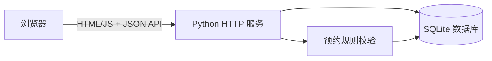

# 高校实验室预约系统设计方案

## 业务范围

选择普通教学实验室，建立“浏览—预约—校验—查询—取消”的最小闭环。三个示例实验室和 08:00—22:00 开放时间均为演示数据，不代表学校实际安排。

## 架构

后端使用 Python 标准库 `http.server`，数据库为 SQLite。预约创建使用 `BEGIN IMMEDIATE`，先检查同一实验室是否存在 `已有开始 < 新结束` 且 `已有结束 > 新开始` 的记录，再写入，以降低并发重复预约风险。用户输入通过参数化 SQL 保存；前端使用 `textContent` 显示数据，避免把预约内容当 HTML 执行。

## 数据模型

- `labs`：编号、名称、容量、地点。
- `bookings`：编号、实验室编号、预约人、用途、人数、起止时间、创建时间。

预约规则：同一天、时长大于 0 且不超过 4 小时，时间在 08:00—22:00，人数不超过容量，同实验室时段不得重叠。不同实验室可同时预约，相邻时段允许。

## 交付与扩展

MVP 可在本机运行并通过自动测试验证核心规则。正式校内部署前，应增加统一身份认证、角色与审批、安全准入、通知、审计日志、备份、隐私保护及部署监控。由于当前没有校方接口和真实业务数据，方案不声称已完成这些集成。

