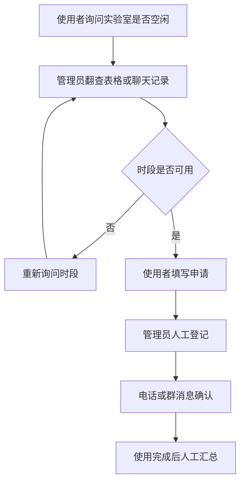
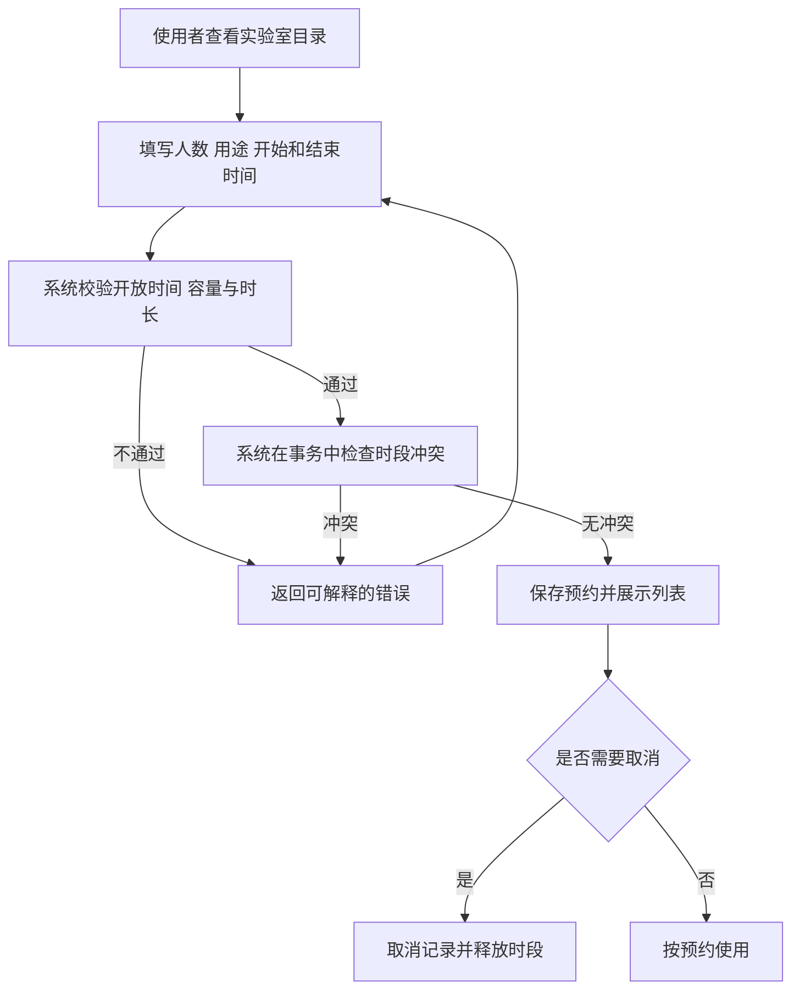
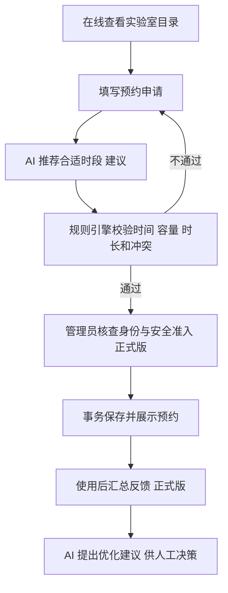

# 预约流程图

以下“现状”是未经校方访谈验证的课程假设；“改造后”是本 MVP 的目标流程。正式项目应以现场访谈和制度文件修订。

提交用 JPG：[现状线状流程图](线状流程图-现状.jpg)；[AI 改进流程图](AI改进流程图.jpg)。

## 现状流程 假设

## 数字化后 MVP 流程

正式版还需在提交与入场之间补充身份、审批、安全培训和准入检查。

## AI 改进流程 规划

AI 只参与时段推荐和使用情况分析；预约是否合法仍由确定性规则判断，身份、安全准入及审批仍由管理员负责。紫色节点目前未在 MVP 中实现。

